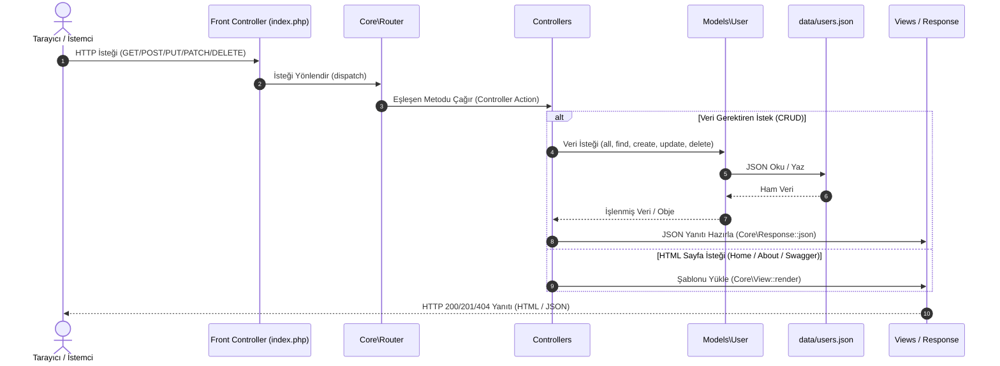

# 🎓 Alumni Tracking System (Mezun Takip Sistemi)

> **26-27 Web Programming Dersi Dönem Projesi**  
> **Ders:** YBSB3001 · Web Programming · Doç. Dr. Emre Akadal · İstanbul Üniversitesi İktisat Fakültesi YBS  
> **Repo:** [github.com/tegmenbugo/alumni](https://github.com/tegmenbugo/alumni)

---

## 📌 Proje Amacı ve Kapsamı
Bu sistem, üniversite mezunları ile mevcut öğrenciler ve yönetim arasındaki iletişimi güçlendiren, mezunların kariyer yolculuklarını (kurum, pozisyon, sektör, iletişim) takip eden ve staj/iş fırsatlarını bir araya getiren web tabanlı bir Mezun Takip Platformudur.

---

## 🚀 Hızlı Başlangıç (One-Command Execution)

Dersin temel kuralı uyarınca sistem tek bir komutla ayağa kalkmaktadır:

```bash
# 1. Ortam şablonunu kopyala
cp .example.env .env

# 2. Tek komutla ayağa kaldır (Web + Veritabanı)
docker compose up -d

# 3. İsteğe bağlı: Tohum verileri ve UserFactory çalıştır
php seed.php
```

Komut çalıştıktan sonra tarayıcınızdan şu adrese gidebilirsiniz:
👉 **`http://localhost:8000`** *(veya `http://localhost`)*

*(Alternatif olarak yerel PHP ortamında çalıştırmak için: `php -S localhost:8000 index.php`)*

---

## 🛡️ Asla Aşılmayacak Mimari ve Veri Kuralları (System Invariants)

Doç. Dr. Emre Akadal'ın ders standartları gereğince bu projede **asla taviz verilmeyecek 6 altın kural**:

1. **`ddd.md` Canlı Veri Sözleşmesi (Living Documentation & Self-Updating Rule):**  
   Sistemdeki herhangi bir varlık, tablo, sütun, ilişki, model veya migrasyon değiştiğinde; [ddd.md](./ddd.md) (Data Design Documentation) dosyası **derhal ve eksiksiz olarak güncellenir**. `ddd.md` veritabanının yegane doğruluk kaynağıdır (Single Source of Truth). Dokümantasyonu güncellenmemiş hiçbir kod değişikliği tamamlanmış sayılamaz.
2. **Hassas Veri ve Gizlilik Yasağı (.env vs .example.env):**  
   Hiçbir veritabanı parolası, gizli anahtar veya API tokenı GitHub'a yüklenemez. `.env` dosyası daima `.gitignore` altındadır. Repoda yalnızca şifresiz ve zararsız şablon olan `.example.env` yer alır.
3. **Konteyner Veri Kalıcılığı ("The Forgetting Test"):**  
   Docker konteynerleri geçicidir (ephemeral). Ancak veritabanı asla unutamaz; host volume mount (`./data:/var/www/html/data` veya `db_data`) kullanılarak `docker compose down` ve `docker compose up` döngülerinde verilerin %100 kalıcı olması zorunludur.
4. **SQL Enjeksiyonuna Karşı Sıfır Tolerans (Prepared Statements):**  
   Modellerde ve denetleyicilerde dinamik metin birleştirme ile SQL yazılması (`"SELECT ... " . $input`) kesinlikle yasaktır. İstisnasız tüm sorgular PDO Prepared Statements üzerinden parametrik olarak yürütülür.
5. **Tek Komutla Çalışma Prensibi (One-Command Execution):**  
   Sistem, karmaşık kurulum adımları olmaksızın `docker compose up` ile tek komutta ayağa kalkmalıdır.
6. **Sürekli API & Swagger Senkronizasyonu:**  
   Eklenen veya değiştirilen her API rotası eş zamanlı olarak OpenAPI şemasında (`/api/openapi.json`) ve Swagger UI (`/api/swagger`) üzerinde güncel tutulmalıdır.

---

## 🏛️ Hafta 04: MVC (Model-View-Controller) Mimarisi

Dersin 4. haftası kapsamında uygulama, harici bir framework'ün "büyülü" arka planına sığınmadan; web programlamanın temel yapı taşlarını ve sorumlulukların ayrışması (Separation of Concerns) ilkesini en şeffaf şekilde ortaya koyan **Saf (Native) PHP 8.3 Nesne Yönelimli MVC Mimarisi** ile yeniden yapılandırılmıştır.

### 🔄 MVC İstek Yaşam Döngüsü (Request Lifecycle)



---

### 📂 MVC Dizin ve Dosya Yapısı (Directories, Folders & Files)

```text
alumni/
├── database/                           # [VERİTABANI MİGRASYONLARI]
│   └── migrations/                     # ddd.md şemasına göre SQL migrasyon betikleri
│       ├── 001_create_users_table.sql
│       ├── 002_create_profiles_table.sql
│       ├── 003_create_education_history_table.sql
│       ├── 004_create_work_experiences_table.sql
│       ├── 005_create_skills_tables.sql
│       ├── 006_create_job_postings_tables.sql
│       ├── 007_seed_initial_data.sql
│       └── 008_update_job_postings_table.sql # [Hafta 06 - Görev 2] Bekleyen migrasyon
│
├── data/                               # [KALICI VERİ DEPOSU (Volume)]
│   ├── alumni.sqlite                   # SQLite veritabanı dosyası
│   └── users.json                      # JSON başlangıç veri deposu
│
├── src/                                # [UYGULAMA ÇEKİRDEĞİ & İŞ MANTIĞI]
│   ├── Core/                           # Çekirdek Altyapı Sınıfları
│   │   ├── Database.php                # PDO bağlantı yöneticisi (SQLite & MySQL)
│   │   ├── Env.php                     # .env ortam değişkenleri ayrıştırıcı (Görev 4)
│   │   ├── Migration.php               # ddd.md migrasyon koşucu (Görev 5)
│   │   ├── Router.php                  # Dinamik regex rota çözümleyici
│   │   ├── Response.php                # JSON, Text ve Redirect HTTP yanıt üreticisi
│   │   └── View.php                    # HTML şablon renderer
│   │
│   ├── Models/                         # [MODEL KATMANI (M) - Hafta 06 (Görev 3)]
│   │   ├── User.php                    # Kullanıcı modeli (İş ilanları ve başvuru ilişkileri ile)
│   │   ├── JobPosting.php              # [YENİ] İş İlanı modeli (BelongsTo User, HasMany Applications)
│   │   └── JobApplication.php          # [YENİ] Başvuru modeli (BelongsTo JobPosting, BelongsTo User)
│   │
│   └── Controllers/                    # [CONTROLLER KATMANI (C)]
│       ├── UserController.php          # [Web Controller] HTML arayüz CRUD işlemleri (/users)
│       ├── ApiUserController.php       # [REST API Controller] JSON CRUD uç noktaları (/api/users)
│       ├── HomeController.php          # Web sayfaları (/, /hello, /sum, /about, /Alumni)
│       └── ApiController.php           # Sistem sağlığı (/api/health), Migrasyonlar (/api/migrations) ve Swagger
│
├── views/                              # [VIEW KATMANI (V)]
│   ├── home.php                        # Ana kontrol paneli ve uç nokta test arayüzü
│   ├── about.php                       # Proje hakkında sayfası
│   ├── swagger.php                     # Swagger UI canlı dokümantasyon sayfası
│   └── users/                          # Mezun web arayüz şablonları (index, show, edit)
│
├── .example.env                        # [ORTAM ŞABLONU - Görev 4] Şifresiz güvenli env şablonu (Git'e yüklenir)
├── .env.example                        # [ALTERNATİF ŞABLON] Standart env şablon kopyası
├── .env                                # [YEREL ORTAM] Hassas veriler (Git'te İGNORLANIR)
├── migrate.php                         # [MİGRASYON CLI - Görev 5] php migrate.php komut satırı arayüzü
├── ddd.md                              # [DATA DESIGN - Hafta 05] Kapsamlı veri sözlüğü ve ERD şeması
├── Dockerfile                          # Konteyner tanımı (PHP 8.3 + Apache + pdo_mysql)
├── docker-compose.yml                  # [GÖREV 3] Web + MySQL servisleri ve persistent volume
├── index.php                           # [FRONT CONTROLLER] Tek giriş kapısı
├── .htaccess                           # Apache URL rewrite motoru
├── .gitignore                          # Sürüm kontrolü dışı dosyalar (.env korumalı)
└── README.md                           # Proje mimarisi ve dokümantasyonu
```

---

### 🧩 MVC Katmanlarının Sorumlulukları

| Katman | Konum | Sorumluluk ve Görev Tanımı |
| :--- | :--- | :--- |
| **Front Controller** | `index.php` | Sistemin tek kapısıdır. PSR-4 standartlarında otomatik yükleyiciyi (Autoloader) başlatır, CORS ayarlarını yapar, rotaları tanımlar ve isteği `Router`'a iletir. |
| **Model (M)** | `src/Models/User.php` | **(Görev 2)** Veritabanı bağlantısını PDO (`Core\Database`) üzerinden kurar. SQL Prepared Statements kullanarak tüm CRUD (Create, Read, Update, Patch, Delete) operasyonlarını yürütür. Controller veritabanı sorgularının detayını bilmez; veritabanı mantığı Model içinde kapsüllenir. |
| **View (V)** | `views/*.php` | Kullanıcının gördüğü sunum katmanıdır. `Core\View` sınıfı üzerinden çağrılır. Controller'dan aktarılan verileri modern HTML5 ve Bootstrap 5 bileşenleriyle görselleştirir. |
| **Web Controller (C)** | `src/Controllers/UserController.php` | **(Görev 3)** Tarayıcı kullanıcıları için mezun yönetimini sağlar. `GET /users`, `GET /users/{id}`, `POST /users` (Create), `POST /users/{id}/update` (Update), `POST /users/{id}/delete` (Delete) metodlarıyla HTML View üretir veya yönlendirme (redirect) yapar. |
| **API Controller (C)** | `src/Controllers/ApiUserController.php` | **(Görev 3)** İstemciler/Swagger/Mobil uygulamalar için REST API hizmeti sunar. `GET /api/users`, `POST /api/users`, `GET /api/users/{id}`, `PUT /api/users/{id}`, `PATCH /api/users/{id}`, `DELETE /api/users/{id}` metodlarıyla JSON formatında yanıt üretir. |
| **Core Engine** | `src/Core/*` | MVC omurgasını oluşturan `Database` (PDO Singleton), `Router`, `Response` ve `View` motorudur. Harici framework kütüphanesi olmadan RESTful rotaları ve HTTP durum kodlarını yönetir. |

---

## 🛠️ Teknoloji Tercihleri ve Savunması (Stack Justification)

*Ders sözleşmesi gereğince seçilen teknolojiler ve zayıf yönleri:*

### 1. Backend: PHP 8.3 (Native & OOP MVC)
* **Neden Seçildi?** Web'in doğal dili olarak sıfır ek bağımlılıkla request-response döngüsünü, HTTP oturumlarını (session) ve routing mantığını en şeffaf şekilde yönetmeyi sağlar.
* **Zayıf Olduğu Yön:** Asenkron I/O (event loop) ve CPU-yoğun uzun süreli arka plan iş parçacıklarını Node.js veya Go kadar doğal desteklemez; her istek tipik olarak yeni bir proses yaşam döngüsünde çalışır.

### 2. Veritabanı: MySQL / MariaDB (Relational)
* **Neden Seçildi?** Mezun profilleri, iş ilanları ve yetkilendirme modelleri arasındaki katı ilişkiler (Foreign Keys) ve ACID işlem güvenliği için en uygun çözümdür.
* **Zayıf Olduğu Yön:** Yatayda ölçekleme (horizontal scaling / sharding) ve esnek şemasız veri yapıları (NoSQL) gerektiren durumlarda yapılandırması karmaşıktır.

### 3. Yapay Zeka Asistanı: Antigravity
* **Kullanılan Asistan:** Antigravity (Google DeepMind)
* **Kullanım Kapsamı:** Mimari tasarım, kod yazımı ve hata ayıklama süreçlerinde ders kurallarına uygun eşlikçi geliştirici olarak kullanılmaktadır.

---

## 🌐 Web Arayüzü & REST API Uç Noktaları

Sistemde iki ayrı Controller üzerinden hem son kullanıcılar için HTML tabanlı web sayfaları, hem de harici istemciler/Swagger için REST API hizmeti sunulmaktadır:

### 1. Web Controller (`UserController`) - HTML Arayüzü & Görünüm Katmanı (View Layer - Görev 5)
> **Not:** Bu rotalar API/JSON **döndürmez**. Doğrudan tarayıcıda çalışan ve Bootstrap 5 ile biçimlendirilmiş saf HTML kullanıcı arayüzü (`views/users/index.php`) sunar.

| Metod | Rota (Route) | Controller Metodu | Yanıt Formatı | Açıklama |
| :--- | :--- | :--- | :--- | :--- |
| `GET` | `/users` | `UserController::index()` | `text/html` (View) | Mezun listesi arayüzü ve yeni mezun ekleme formu |
| `POST` | `/users` | `UserController::store()` | `text/html` (View) | HTML formundan yeni mezun kaydı ve güncel liste arayüzü |
| `GET` | `/users/{id}` | `UserController::show($id)` | `text/html` (View) | Tekil mezun detay profil kartı |
| `POST` | `/users/{id}/update` | `UserController::update($id)` | `text/html` (View) | Web formu üzerinden mezun güncelleme |
| `POST` | `/users/{id}/delete` | `UserController::destroy($id)` | `text/html` (View) | Web arayüzü üzerinden mezun silme |

### 2. REST API Controller (`ApiUserController`) - JSON Giriş/Çıkış
* **Swagger UI Canlı Dokümantasyonu:** `http://localhost:8000/api/swagger`
* **OpenAPI 3.0 Şeması:** `http://localhost:8000/api/openapi.json`

| Metod | Uç Nokta (Endpoint) | Controller Metodu | Açıklama |
| :--- | :--- | :--- | :--- |
| `GET` | `/api/health` | `ApiController::health()` | Servis sağlık kontrolü (JSON) |
| `GET` | `/api/users` | `ApiUserController::index()` | Tüm mezunları JSON olarak listeleme (Read All) |
| `POST` | `/api/users` | `ApiUserController::store()` | Yeni mezun oluşturma (JSON input - 201 Created) |
| `GET` | `/api/users/{id}` | `ApiUserController::show($id)` | ID ile mezun getirme (Read One - 200 / 404) |
| `PUT` | `/api/users/{id}` | `ApiUserController::update($id)` | Mezunu tamamen güncelleme (Full Update) |
| `PATCH` | `/api/users/{id}` | `ApiUserController::patch($id)` | Mezun alanını kısmen güncelleme (Partial Update) |
| `DELETE` | `/api/users/{id}` | `ApiUserController::destroy($id)` | Mezun kaydını silme (Delete - 200 / 404) |

### 📜 Swagger & API Dokümantasyon Senkronizasyon İlkesi (Continuous API Documentation Policy)

> **Mimari Kural & Geliştirme İlkesi:**  
> Projede eklenen, güncellenen veya silinen her API rotası ve controller operasyonu (`ApiUserController`, `ApiController` vb.) için Swagger UI (`/api/swagger`) ve OpenAPI 3.0 şeması (`/api/openapi.json`) **her seferinde otomatik olarak senkronize edilir ve güncel tutulur.**  
> Kod tabanındaki değişikliklerin dokümantasyona yansıtılması projenin ayrılmaz bir gerekliliği ve birinci sınıf sözleşmesi (API contract) olduğundan; her geliştirme adımında ayrıca *"Swagger'ı güncelleyin"* uyarısı yapmaya gerek kalmaksızın dokümantasyon sürekliliği sistem seviyesinde garanti altındadır.

---

## 🗄️ Veri Mimarisi, Ortam Değişkenleri ve Migrasyonlar (Hafta 05)

Projenin kapsamlı etki alanı (domain) analizi, varlık-ilişki diyagramı (ERD), veri sözlüğü, SQL DDL şeması ve sentetik tohum veri kümesi bağımsız bir mimari sözleşme olarak **`ddd.md`** dosyasında belgelenmiştir:

👉 **[Kapsamlı Veri Tasarım Dokümanı (ddd.md)](./ddd.md)**

### 1. Ortam Değişkenleri İlkesi (.env vs .example.env - Görev 4)
* **Altın Kural:** Şifreler, veritabanı parolaları ve gizli anahtarlar **asla** Git'e yüklenmez. `.env` dosyası `.gitignore` ile korunmaktadır.
* **Şablon (.example.env / .env.example):** Projeyi klonlayan geliştiricilerin hangi değişkenlere ihtiyaç duyduğunu görebilmesi için parolasız ve zararsız örnek değerler içeren `.example.env` dosyası repoda tutulur:
  ```bash
  # Projeyi ayağa kaldırmadan önce şablonu kopyalayınız:
  cp .example.env .env
  ```

### 2. Veritabanı ve Docker Compose Mimarisi (Görev 3)
[docker-compose.yml](./docker-compose.yml) dosyası veritabanı gereksinimlerine göre güncellenmiştir:
* **`web` Servisi:** PHP 8.3 + Apache + `pdo_mysql` + `pdo_sqlite` sürücüleri.
* **`db` Servisi:** MySQL 8.0 veritabanı sunucusu.
* **Kalıcı Veri Hacmi (`db_data` Volume):** MySQL verileri `db_data:/var/lib/mysql` üzerinde saklanır.
* **SQLite Uyumluluğu:** SQLite verileri `./data:/var/www/html/data` üzerinde tutulur.

### 3. ddd.md Şemasına Göre Veritabanı Üretimi ve Migrasyon (Görev 5)
Sistem, `ddd.md` dokümanındaki 8 tabloyu ve sentetik tohum verilerini otomatik olarak oluşturabilen migrasyon altyapısına sahiptir:
* **Migrasyon Dosyaları:** `database/migrations/*.sql`
* **Komut Satırı (CLI) Migrasyon Çalıştırıcı:**
  ```bash
  # Tüm bekleyen migrasyonları uygular:
  php migrate.php

  # Migrasyon durumunu listeler:
  php migrate.php --status
  ```
* **Canlı API Uç Noktası:** `GET /api/migrations` (Tüm tabloların ve migrasyonların durumunu JSON olarak döner).

### 🛡️ "The Forgetting Test" (Unutma Testi) ve Konteyner Veri Kalıcılığı
Docker mimarisinde konteynerlar kapatılıp yok edildiğinde (`docker compose down`) geçici katmandaki veriler silinir. Bu durumun önüne geçmek ve veritabanı sürekliliğini garanti altına almak için sistemde **Host Bind Mount** ve **Named Volume** mimarisi uygulanmıştır:

* **SQLite Bağlantısı:** `./data:/var/www/html/data`
* **MySQL Bağlantısı:** `db_data:/var/lib/mysql`
* **Test Protokolü:**
  1. `docker compose up -d` ile sistem ayağa kaldırılır.
  2. Web arayüzü (`/users`) veya REST API (`POST /api/users`) üzerinden yeni bir mezun kaydı eklenir.
  3. `docker compose down` komutuyla konteyner tamamen kapatılır ve yok edilir.
  4. `docker compose up -d` ile konteyner yeniden başlatıldığında, eklenen kaydın `data/alumni.sqlite` veya `db_data` üzerinde **korunduğu ve asla unutulmadığı** doğrulanır.
* Detaylı analiz, ERD ve şema tanımları için bkz: **[ddd.md — Bölüm 7 (Veri Kalıcılığı Analizi)](./ddd.md#-7-veri-kalıcılığı-ve-the-forgetting-test-analizi)**.

---

## 🗓️ Dönem Yol Haritası (Fourteen Weeks Roadmap)

* [x] **Week 01:** Project inception & fundamentals, repository setup, stack selection & justification.
* [x] **Week 02:** Routing — the doors of the system (GET endpoints: `/Alumni`, `/hello`, `/hello/{name}`, `/sum/{n1}/{n2}`, `/about`, `/`).
* [x] **Week 03:** HTTP methods & CRUD on `/api/users` (GET, POST, PUT, PATCH, DELETE) + Swagger UI at `/api/swagger`.
* [x] **Week 04:** MVC architecture (Decoupled Front Controller, Router, Controllers [UserController & ApiUserController], Models [PDO User], Views, and synchronized Swagger UI).
* [x] **Week 05:** Database & ORM — Data Design Documentation (`ddd.md`), Docker Compose Database Service (`db`), Environment Variables (`.env` vs `.example.env`), Migration Engine (`migrate.php`), and passing "The Forgetting Test".
* [x] **Week 06:** Database integration & multi-table relationships — Updated `job_postings` table in `ddd.md`, created `008_update_job_postings_table.sql` migration (pending/unmigrated), and implemented `JobPosting` & `JobApplication` relational models with `User` relationships.
* [ ] **Week 07:** Relational data & advanced routing.
* [ ] **Week 08:** Midterm — code review.
* [ ] **Week 09:** Middleware — the bouncer.
* [ ] **Week 10:** Views & front-end integration.
* [ ] **Week 11:** Authentication & authorization.
* [ ] **Week 12:** Service layers.
* [ ] **Week 13:** Deployment & CI/CD.
* [ ] **Week 14:** Final presentations — system handover.
