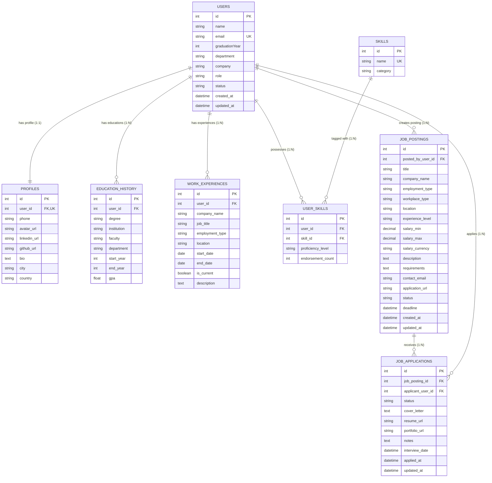

# 🗄️ Alumni Tracking System — Data Design Documentation (DDD)

> **26-27 Web Programming Dersi Dönem Projesi · Veri Tasarım ve Mimari Dokümantasyonu**  
> **Ders:** YBSB3001 · Web Programming · Doç. Dr. Emre Akadal · İstanbul Üniversitesi İktisat Fakültesi YBS  
> **Geliştirici:** Battal Buğra Karataş ([@tegmenbugo](https://github.com/tegmenbugo))  
> **Ana Dokümantasyon:** [README.md](./README.md) · **Canlı Sistem:** `http://localhost:8000`

---

## 📌 1. Dokümantasyonun Amacı ve Kapsamı

Bu doküman (**Data Design Documentation - `ddd.md`**), Mezun Takip Sistemi'nin (Alumni Tracking System) veritabanı şemasını, etki alanı (domain) varlıklarını, ilişkilerini, veri sözlüğünü, kısıtlamalarını ve sentetik veri kümesini en ince ayrıntısına kadar tanımlamak üzere hazırlanmıştır.

Doç. Dr. Emre Akadal'ın ders standartları uyarınca:
1. **Yapay Zeka ve Geliştirici Sözleşmesi:** Sistemde henüz canlı bir veritabanı sunucusu veya kurulu veri seti bulunmasa dahi; bir yapay zeka asistanı veya yeni bir yazılımcı yalnızca bu `ddd.md` dosyasını okuyarak sistemin veri mimarisini, tablolar arası bağımlılıkları ve veri yaşam döngüsünü eksiksiz biçimde anlayabilir ve yeniden inşa edebilir.
2. **Konteyner Veri Kalıcılığı ("The Forgetting Test"):** Docker konteynerlerinin geçici (ephemeral) doğasına karşı verilerin `docker compose down` ve `docker compose up` döngülerinde nasıl kalıcı tutulduğu bu dokümanda kanıtlanmaktadır.
3. **README Entegrasyonu:** Bu doküman [README.md](./README.md) ile karşılıklı çapraz referanslı (cross-referenced) çalışmaktadır.

---

## 🏛️ 2. Etki Alanı Analizi ve Alt Sistemler (Domain Analysis)

Mezun Takip Sistemi, üniversite ekosistemindeki mezunlar, aktif öğrenciler, öğretim üyeleri ve işverenler arasındaki bağı sürdüren çok katmanlı bir platformdur. Veri modeli 6 temel alt sisteme ayrılmıştır:

```text
┌────────────────────────────────────────────────────────────────────────┐
│                   ALUMNI TRACKING SYSTEM DOMAIN                        │
├──────────────────┬──────────────────┬──────────────────┬───────────────┤
│ 1. Identity &    │ 2. Education &   │ 3. Professional  │ 4. Skills &   │
│    Profiles      │    Academic      │    Career        │    Endorse    │
│    (users,       │    (education_   │    (work_        │    (skills,   │
│     profiles)    │     history)     │     experiences) │     user_     │
│                  │                  │                  │     skills)   │
├──────────────────┴──────────────────┴──────────────────┴───────────────┤
│ 5. Career Opportunities (job_postings, job_applications)               │
├────────────────────────────────────────────────────────────────────────┤
│ 6. Data Persistence & Integrity Layer (SQLite / MySQL, Transactions)  │
└────────────────────────────────────────────────────────────────────────┘
```

1. **Kimlik ve Profil Yönetimi (Identity & Profiles):** Sisteme giriş yapan mezunların, öğrencilerin ve yöneticilerin kimlik, iletişim, durum ve sosyal medya bilgilerini tutar.
2. **Akademik Geçmiş (Education History):** Mezunların İÜ veya diğer kurumlardaki lisans, yüksek lisans ve doktora derece bilgilerini saklar.
3. **Kariyer ve İş Deneyimi (Work Experiences):** Mezunun geçmiş ve güncel çalışma hayatı, pozisyonları, sektörleri ve şirket bilgilerini kronolojik takip eder.
4. **Yetenekler ve Yetkinlikler (Skills & Endorsements):** Teknik/yönetsel becerileri (PHP, Docker, Veri Analitiği, ERP vb.) ve mezunların bu becerilerle eşleşmesini yönetir.
5. **Kariyer Fırsatları (Job Postings & Applications):** Mezunların veya kurumların açtığı staj ve iş ilanları ile öğrencilerin bu ilanlara başvurularını yönetir.

---

## 📊 3. Varlık-İlişki Diyagramı (Entity Relationship Diagram - ERD)

Aşağıdaki Mermaid ER diyagramı, sistemin tüm varlıklarını, birincil (PK) ve yabancı (FK) anahtarlarını ve kardinalite ilişkilerini göstermektedir:



---

## 📖 4. Veri Sözlüğü ve Şema Detayları (Data Dictionary)

### 4.1. `users` Tablosu (Çekirdek Kullanıcı & Mezun Varlığı)
Sistemin ana varlığıdır. Hafta 03-05 kapsamında doğrudan PDO SQLite (`data/alumni.sqlite`) üzerinde aktiftir ve tam CRUD işlemlerini yönetir.

| Sütun Adı | Veri Tipi | Kısıtlamalar (Constraints) | Varsayılan | Açıklama |
| :--- | :--- | :--- | :--- | :--- |
| `id` | `INTEGER` | PRIMARY KEY, AUTOINCREMENT | - | Benzersiz kullanıcı / mezun numarası |
| `name` | `VARCHAR(150)` | NOT NULL | - | Mezunun ad ve soyadı |
| `email` | `VARCHAR(191)` | UNIQUE, NULL | `NULL` | Üniversite / kurumsal e-posta adresi |
| `graduationYear` | `INTEGER` | CHECK (graduationYear BETWEEN 1950 AND 2040) | `NULL` | Üniversiteden mezun olduğu veya olacağı yıl |
| `department` | `VARCHAR(150)` | NULL | `Yönetim Bilişim Sistemleri` | Mezun olunan akademik bölüm |
| `company` | `VARCHAR(150)` | NULL | `NULL` | Güncel çalıştığı şirket veya kurum |
| `role` | `VARCHAR(50)` | NOT NULL | `'alumnus'` | Sistem rolü (`alumnus`, `student`, `admin`, `faculty`) |
| `status` | `VARCHAR(30)` | NOT NULL | `'active'` | Hesap durumu (`active`, `pending`, `suspended`) |
| `created_at` | `DATETIME` | NOT NULL | `CURRENT_TIMESTAMP` | Kaydın veritabanına eklenme zamanı |
| `updated_at` | `DATETIME` | NULL | `CURRENT_TIMESTAMP` | Kaydın son güncellenme zamanı |

### 4.2. `profiles` Tablosu (Genişletilmiş Mezun Profili)
Kullanıcının detaylı biyografik, sosyal ağ ve iletişim bilgilerini 1:1 ilişkide saklar.

| Sütun Adı | Veri Tipi | Kısıtlamalar | Açıklama |
| :--- | :--- | :--- | :--- |
| `id` | `INTEGER` | PK, AUTOINCREMENT | Profil ID |
| `user_id` | `INTEGER` | FK (`users.id`), UNIQUE, NOT NULL | İlgili kullanıcı referansı |
| `phone` | `VARCHAR(30)` | NULL | İletişim telefon numarası |
| `avatar_url` | `VARCHAR(255)` | NULL | Profil fotoğrafı URL'i |
| `linkedin_url` | `VARCHAR(255)` | NULL | LinkedIn profesyonel profil bağlantısı |
| `github_url` | `VARCHAR(255)` | NULL | GitHub portfolyo bağlantısı |
| `bio` | `TEXT` | NULL | Mezunun özgeçmiş / kariyer özeti |
| `city` | `VARCHAR(100)` | NULL | İkamet ettiği şehir |
| `country` | `VARCHAR(100)` | DEFAULT `'Türkiye'` | İkamet ettiği ülke |

### 4.3. `education_history` Tablosu (Akademik Geçmiş)
Bir mezunun birden fazla akademik derecesini (1:N) kronolojik takip eder.

| Sütun Adı | Veri Tipi | Kısıtlamalar | Açıklama |
| :--- | :--- | :--- | :--- |
| `id` | `INTEGER` | PK, AUTOINCREMENT | Eğitim kayıt ID |
| `user_id` | `INTEGER` | FK (`users.id`), NOT NULL | İlgili mezun referansı |
| `degree` | `VARCHAR(50)` | NOT NULL | Derece türü (`Lisans`, `Yüksek Lisans`, `Doktora`, `Ön Lisans`) |
| `institution` | `VARCHAR(150)` | NOT NULL | Üniversite / Enstitü adı (Örn: `İstanbul Üniversitesi`) |
| `faculty` | `VARCHAR(150)` | NULL | Fakülte adı (Örn: `İktisat Fakültesi`) |
| `department` | `VARCHAR(150)` | NOT NULL | Bölüm (Örn: `Yönetim Bilişim Sistemleri`) |
| `start_year` | `INTEGER` | NOT NULL | Başlangıç yılı |
| `end_year` | `INTEGER` | NULL | Mezuniyet yılı (Devam ediyorsa NULL) |
| `gpa` | `DECIMAL(3,2)` | CHECK (gpa BETWEEN 0.00 AND 4.00) | Mezuniyet not ortalaması |

### 4.4. `work_experiences` Tablosu (Profesyonel İş Deneyimleri)
Mezunun kariyerindeki pozisyon değişimlerini, şirketleri ve çalışma sürelerini 1:N ilişkide tutar.

| Sütun Adı | Veri Tipi | Kısıtlamalar | Açıklama |
| :--- | :--- | :--- | :--- |
| `id` | `INTEGER` | PK, AUTOINCREMENT | Deneyim kayıt ID |
| `user_id` | `INTEGER` | FK (`users.id`), NOT NULL | İlgili mezun referansı |
| `company_name`| `VARCHAR(150)` | NOT NULL | Şirket / Kurum adı |
| `job_title` | `VARCHAR(100)` | NOT NULL | Unvan (Örn: `Senior Software Engineer`, `Product Manager`) |
| `employment_type` | `VARCHAR(50)` | DEFAULT `'Tam Zamanlı'` | Çalışma biçimi (`Tam Zamanlı`, `Yarı Zamanlı`, `Staj`, `Freelance`) |
| `location` | `VARCHAR(100)` | NULL | Çalışma lokasyonu / şehir |
| `start_date` | `DATE` | NOT NULL | İşe başlangıç tarihi |
| `end_date` | `DATE` | NULL | İşten ayrılma tarihi (Devam ediyorsa NULL) |
| `is_current` | `BOOLEAN` | DEFAULT 0 | Halen bu pozisyonda mı çalışıyor? (1: Evet, 0: Hayır) |
| `description` | `TEXT` | NULL | İş tanımı ve yürütülen sorumluluklar |

### 4.5. `skills` & `user_skills` Tabloları (Yetenek Havuzu - Many to Many)
Mezunların sahip olduğu teknik ve sektörel yetenekleri N:M ilişki ile haritalandırır.

| Tablo | Sütun | Tip | Kısıtlamalar | Açıklama |
| :--- | :--- | :--- | :--- | :--- |
| `skills` | `id` | `INTEGER` | PK, AUTOINCREMENT | Yetenek ID |
| `skills` | `name` | `VARCHAR(100)` | UNIQUE, NOT NULL | Yetenek adı (Örn: `PHP`, `Docker`, `SQL`, `Machine Learning`) |
| `skills` | `category`| `VARCHAR(50)` | DEFAULT `'Teknik'` | Kategori (`Yazılım`, `Veri`, `Yönetim`, `Tasarım`) |
| `user_skills` | `id` | `INTEGER` | PK, AUTOINCREMENT | Eşleşme ID |
| `user_skills` | `user_id` | `INTEGER` | FK (`users.id`), NOT NULL | İlgili kullanıcı |
| `user_skills` | `skill_id` | `INTEGER` | FK (`skills.id`), NOT NULL | İlgili yetenek |
| `user_skills` | `proficiency` | `VARCHAR(30)` | DEFAULT `'Orta'` | Seviye (`Başlangıç`, `Orta`, `İleri`, `Uzman`) |

### 4.6. `job_postings` Tablosu (Kariyer ve İş/Staj İlanları - Hafta 06 Güncellemesi)
Mezunların, partner şirketlerin veya kurum temsilcilerinin açtığı iş/staj ilanlarını ve aday kriterlerini yönetir.

| Sütun Adı | Veri Tipi | Kısıtlamalar (Constraints) | Varsayılan | Açıklama |
| :--- | :--- | :--- | :--- | :--- |
| `id` | `INTEGER` | PRIMARY KEY, AUTOINCREMENT | - | Benzersiz ilan numarası |
| `posted_by_user_id` | `INTEGER` | FK (`users.id`), NOT NULL | - | İlanı oluşturan mezun / kullanıcı referansı |
| `title` | `VARCHAR(150)` | NOT NULL | - | İlan pozisyon başlığı (Örn: `Junior PHP Developer`) |
| `company_name` | `VARCHAR(150)` | NOT NULL | - | İstihdam sağlayan şirket / kurum adı |
| `employment_type` | `VARCHAR(50)` | NOT NULL | `'Tam Zamanlı'` | Çalışma biçimi (`Tam Zamanlı`, `Yarı Zamanlı`, `Staj`, `Sözleşmeli`, `Freelance`) |
| `workplace_type` | `VARCHAR(50)` | NOT NULL | `'Hibrit'` | Çalışma ortamı modeli (`Ofisten`, `Hibrit`, `Uzaktan / Remote`) |
| `location` | `VARCHAR(100)` | NULL | `'İstanbul, Türkiye'` | Şehir / Ülke lokasyon bilgisi |
| `experience_level` | `VARCHAR(50)` | NOT NULL | `'Giriş Seviyesi'` | Deneyim seviyesi (`Stajyer`, `Giriş Seviyesi`, `Orta Seviye`, `Kıdemli`) |
| `salary_min` | `DECIMAL(10,2)` | NULL | `NULL` | Asgari maaş skalası |
| `salary_max` | `DECIMAL(10,2)` | NULL | `NULL` | Azami maaş skalası |
| `salary_currency` | `VARCHAR(10)` | DEFAULT `'TRY'` | `'TRY'` | Maaş para birimi (`TRY`, `USD`, `EUR`) |
| `description` | `TEXT` | NOT NULL | - | Detaylı rol tanımı, sorumluluklar ve şirket tanıtımı |
| `requirements` | `TEXT` | NULL | `NULL` | Aranan teknik/sosyal nitelikler ve yetkinlikler |
| `contact_email` | `VARCHAR(191)` | NULL | `NULL` | Başvuru ve soru iletişim e-postası |
| `application_url` | `VARCHAR(255)` | NULL | `NULL` | Harici başvuru bağlantısı (LinkedIn, Kariyer.net vb.) |
| `status` | `VARCHAR(30)` | NOT NULL | `'active'` | İlan durumu (`active`, `closed`, `draft`, `archived`) |
| `deadline` | `DATE` | NULL | `NULL` | İlan son başvuru tarihi |
| `created_at` | `DATETIME` | NOT NULL | `CURRENT_TIMESTAMP` | İlanın oluşturulma tarihi |
| `updated_at` | `DATETIME` | NULL | `CURRENT_TIMESTAMP` | İlanın son güncellenme tarihi |

### 4.7. `job_applications` Tablosu (İş Başvuruları - Hafta 06 Güncellemesi)
Öğrencilerin ve mezunların açık iş ilanlarına yaptıkları başvuruları, CV bağlantılarını ve değerlendirme süreçlerini yönetir.

| Sütun Adı | Veri Tipi | Kısıtlamalar | Varsayılan | Açıklama |
| :--- | :--- | :--- | :--- | :--- |
| `id` | `INTEGER` | PK, AUTOINCREMENT | - | Başvuru kayıt ID |
| `job_posting_id` | `INTEGER` | FK (`job_postings.id`), NOT NULL | - | İlgili iş ilanı referansı |
| `applicant_user_id`| `INTEGER` | FK (`users.id`), NOT NULL | - | Başvuran mezun / öğrenci referansı |
| `status` | `VARCHAR(30)` | NOT NULL | `'applied'` | Durum (`applied`, `reviewing`, `interview`, `accepted`, `rejected`, `withdrawn`) |
| `cover_letter` | `TEXT` | NULL | `NULL` | Ön yazı ve motivasyon mektubu |
| `resume_url` | `VARCHAR(255)` | NULL | `NULL` | CV / Özgeçmiş PDF bağlantısı |
| `portfolio_url` | `VARCHAR(255)` | NULL | `NULL` | GitHub / Portfolyo bağlantısı |
| `notes` | `TEXT` | NULL | `NULL` | İşe alım yöneticisi mülakat ve değerlendirme notları |
| `interview_date`| `DATETIME` | NULL | `NULL` | Planlanan mülakat tarihi |
| `applied_at` | `DATETIME` | NOT NULL | `CURRENT_TIMESTAMP` | Başvuru zaman damgası |
| `updated_at` | `DATETIME` | NULL | `CURRENT_TIMESTAMP` | Durum güncelleme zaman damgası |

---

## 💻 5. Veri Tanımlama Dili (DDL - Data Definition Language)

Aşağıdaki SQL betiği, SQLite ve MySQL motorlarında tam uyumlu çalışacak standart ANSI SQL DDL sözdizimi ile hazırlanmıştır:

```sql
-- =============================================================================
-- ALUMNI TRACKING SYSTEM - DDL SCHEMA DEFINITION
-- =============================================================================

-- 1. USERS TABLOSU (Aktif Çekirdek Tablo)
CREATE TABLE IF NOT EXISTS users (
    id INTEGER PRIMARY KEY AUTOINCREMENT,
    name VARCHAR(150) NOT NULL,
    email VARCHAR(191) UNIQUE,
    graduationYear INTEGER CHECK (graduationYear BETWEEN 1950 AND 2040),
    department VARCHAR(150) DEFAULT 'Yönetim Bilişim Sistemleri',
    company VARCHAR(150),
    role VARCHAR(50) DEFAULT 'alumnus',
    status VARCHAR(30) DEFAULT 'active',
    created_at DATETIME DEFAULT CURRENT_TIMESTAMP,
    updated_at DATETIME DEFAULT CURRENT_TIMESTAMP
);

CREATE INDEX IF NOT EXISTS idx_users_email ON users(email);
CREATE INDEX IF NOT EXISTS idx_users_grad_year ON users(graduationYear);

-- 2. PROFILES TABLOSU (1:1 Genişletilmiş Profil)
CREATE TABLE IF NOT EXISTS profiles (
    id INTEGER PRIMARY KEY AUTOINCREMENT,
    user_id INTEGER UNIQUE NOT NULL,
    phone VARCHAR(30),
    avatar_url VARCHAR(255),
    linkedin_url VARCHAR(255),
    github_url VARCHAR(255),
    bio TEXT,
    city VARCHAR(100),
    country VARCHAR(100) DEFAULT 'Türkiye',
    FOREIGN KEY (user_id) REFERENCES users(id) ON DELETE CASCADE
);

-- 3. EDUCATION_HISTORY TABLOSU (1:N Akademik Geçmiş)
CREATE TABLE IF NOT EXISTS education_history (
    id INTEGER PRIMARY KEY AUTOINCREMENT,
    user_id INTEGER NOT NULL,
    degree VARCHAR(50) NOT NULL,
    institution VARCHAR(150) NOT NULL,
    faculty VARCHAR(150),
    department VARCHAR(150) NOT NULL,
    start_year INTEGER NOT NULL,
    end_year INTEGER,
    gpa DECIMAL(3,2),
    FOREIGN KEY (user_id) REFERENCES users(id) ON DELETE CASCADE
);

CREATE INDEX IF NOT EXISTS idx_education_user ON education_history(user_id);

-- 4. WORK_EXPERIENCES TABLOSU (1:N Profesyonel Deneyim)
CREATE TABLE IF NOT EXISTS work_experiences (
    id INTEGER PRIMARY KEY AUTOINCREMENT,
    user_id INTEGER NOT NULL,
    company_name VARCHAR(150) NOT NULL,
    job_title VARCHAR(100) NOT NULL,
    employment_type VARCHAR(50) DEFAULT 'Tam Zamanlı',
    location VARCHAR(100),
    start_date DATE NOT NULL,
    end_date DATE,
    is_current BOOLEAN DEFAULT 0,
    description TEXT,
    FOREIGN KEY (user_id) REFERENCES users(id) ON DELETE CASCADE
);

CREATE INDEX IF NOT EXISTS idx_experience_user ON work_experiences(user_id);

-- 5. SKILLS & USER_SKILLS TABLOLARI (N:M Yetenekler)
CREATE TABLE IF NOT EXISTS skills (
    id INTEGER PRIMARY KEY AUTOINCREMENT,
    name VARCHAR(100) UNIQUE NOT NULL,
    category VARCHAR(50) DEFAULT 'Teknik'
);

CREATE TABLE IF NOT EXISTS user_skills (
    id INTEGER PRIMARY KEY AUTOINCREMENT,
    user_id INTEGER NOT NULL,
    skill_id INTEGER NOT NULL,
    proficiency_level VARCHAR(30) DEFAULT 'Orta',
    FOREIGN KEY (user_id) REFERENCES users(id) ON DELETE CASCADE,
    FOREIGN KEY (skill_id) REFERENCES skills(id) ON DELETE CASCADE,
    UNIQUE(user_id, skill_id)
);

-- 6. JOB_POSTINGS & JOB_APPLICATIONS TABLOLARI (Kariyer Fırsatları - Hafta 06)
CREATE TABLE IF NOT EXISTS job_postings (
    id INTEGER PRIMARY KEY AUTOINCREMENT,
    posted_by_user_id INTEGER NOT NULL,
    title VARCHAR(150) NOT NULL,
    company_name VARCHAR(150) NOT NULL,
    employment_type VARCHAR(50) DEFAULT 'Tam Zamanlı',
    workplace_type VARCHAR(50) DEFAULT 'Hibrit',
    location VARCHAR(100) DEFAULT 'İstanbul, Türkiye',
    experience_level VARCHAR(50) DEFAULT 'Giriş Seviyesi',
    salary_min DECIMAL(10,2),
    salary_max DECIMAL(10,2),
    salary_currency VARCHAR(10) DEFAULT 'TRY',
    description TEXT NOT NULL,
    requirements TEXT,
    contact_email VARCHAR(191),
    application_url VARCHAR(255),
    status VARCHAR(30) DEFAULT 'active',
    deadline DATE,
    created_at DATETIME DEFAULT CURRENT_TIMESTAMP,
    updated_at DATETIME DEFAULT CURRENT_TIMESTAMP,
    FOREIGN KEY (posted_by_user_id) REFERENCES users(id) ON DELETE CASCADE
);

CREATE INDEX IF NOT EXISTS idx_job_postings_user ON job_postings(posted_by_user_id);
CREATE INDEX IF NOT EXISTS idx_job_postings_status ON job_postings(status);
CREATE INDEX IF NOT EXISTS idx_job_postings_company ON job_postings(company_name);

CREATE TABLE IF NOT EXISTS job_applications (
    id INTEGER PRIMARY KEY AUTOINCREMENT,
    job_posting_id INTEGER NOT NULL,
    applicant_user_id INTEGER NOT NULL,
    status VARCHAR(30) DEFAULT 'applied',
    cover_letter TEXT,
    resume_url VARCHAR(255),
    portfolio_url VARCHAR(255),
    notes TEXT,
    interview_date DATETIME,
    applied_at DATETIME DEFAULT CURRENT_TIMESTAMP,
    updated_at DATETIME DEFAULT CURRENT_TIMESTAMP,
    FOREIGN KEY (job_posting_id) REFERENCES job_postings(id) ON DELETE CASCADE,
    FOREIGN KEY (applicant_user_id) REFERENCES users(id) ON DELETE CASCADE,
    UNIQUE(job_posting_id, applicant_user_id)
);

CREATE INDEX IF NOT EXISTS idx_job_apps_status ON job_applications(status);
```

---

## 🧪 6. Sentetik Tohum Veri Kümesi (Synthetic Seed Dataset)

Yapay zeka modellerinin ve geliştiricilerin sıfır harici veritabanı ile sistemi anında test edebilmesi için gerçekçi İstanbul Üniversitesi YBS mezun senaryolarına dayanan sentetik tohum veri kümesi aşağıdadır:

### 6.1. JSON Formatında Tohum Verisi (`data/users.json`)
```json
[
  {
    "id": 1,
    "name": "Elif Kaya",
    "email": "elif.kaya@alumni.iu.edu.tr",
    "graduationYear": 2024,
    "department": "Yönetim Bilişim Sistemleri",
    "company": "Trendyol",
    "role": "alumnus",
    "status": "active"
  },
  {
    "id": 2,
    "name": "Mert Aydın",
    "email": "mert.aydin@alumni.iu.edu.tr",
    "graduationYear": 2021,
    "department": "Yönetim Bilişim Sistemleri",
    "company": "QNB Finansbank",
    "role": "alumnus",
    "status": "active"
  },
  {
    "id": 3,
    "name": "Zeynep Arslan",
    "email": "zeynep.arslan@alumni.iu.edu.tr",
    "graduationYear": 2019,
    "department": "İktisat",
    "company": "Hepsiburada",
    "role": "alumnus",
    "status": "active"
  },
  {
    "id": 4,
    "name": "Can Öztürk",
    "email": "can.ozturk@alumni.iu.edu.tr",
    "graduationYear": 2023,
    "department": "İşletme",
    "company": "McKinsey & Company",
    "role": "alumnus",
    "status": "active"
  },
  {
    "id": 5,
    "name": "Battal Buğra Karataş",
    "email": "bugrakaratas@alumni.iu.edu.tr",
    "graduationYear": 2027,
    "department": "Yönetim Bilişim Sistemleri",
    "company": "Akadal Technology",
    "role": "student",
    "status": "active"
  }
]
```

### 6.2. SQL Insert Betiği
```sql
-- USERS BAŞLANGIÇ VERİLERİ
INSERT INTO users (id, name, email, graduationYear, department, company, role, status) VALUES
(1, 'Elif Kaya', 'elif.kaya@alumni.iu.edu.tr', 2024, 'Yönetim Bilişim Sistemleri', 'Trendyol', 'alumnus', 'active'),
(2, 'Mert Aydın', 'mert.aydin@alumni.iu.edu.tr', 2021, 'Yönetim Bilişim Sistemleri', 'QNB Finansbank', 'alumnus', 'active'),
(3, 'Zeynep Arslan', 'zeynep.arslan@alumni.iu.edu.tr', 2019, 'İktisat', 'Hepsiburada', 'alumnus', 'active'),
(4, 'Can Öztürk', 'can.ozturk@alumni.iu.edu.tr', 2023, 'İşletme', 'McKinsey & Company', 'alumnus', 'active'),
(5, 'Battal Buğra Karataş', 'bugrakaratas@alumni.iu.edu.tr', 2027, 'Yönetim Bilişim Sistemleri', 'Akadal Technology', 'student', 'active');

-- SKILLS BAŞLANGIÇ VERİLERİ
INSERT INTO skills (name, category) VALUES
('PHP 8.3 & OOP MVC', 'Yazılım'),
('Docker & Docker Compose', 'DevOps'),
('Relational Database & SQL', 'Veri'),
('RESTful API & Swagger', 'Yazılım'),
('Data Analysis & BI', 'Veri');

-- USER_SKILLS EŞLEŞTİRMELERİ
INSERT INTO user_skills (user_id, skill_id, proficiency_level) VALUES
(1, 1, 'İleri'),
(1, 4, 'İleri'),
(2, 3, 'Uzman'),
(5, 1, 'İleri'),
(5, 2, 'İleri');
```

---

## 🛡️ 7. Veri Kalıcılığı ve "The Forgetting Test" Analizi

### 7.1. Problem: Konteynerların Geçici (Ephemeral) Doğası
Docker mimarisinde bir konteyner başlatıldığında, konteyner içinde üretilen tüm yeni veriler ve dosya değişiklikleri varsayılan olarak konteynerın yazılabilir katmanında (writable layer) saklanır.
Eğer bir geliştirici konteyneri `docker compose down` komutuyla yok ederse (destroy):
* Konteyner imajı hariç tüm çalışma zamanı verisi **SİLİNİR**.
* Sistem yeniden `docker compose up` ile başlatıldığında sonradan eklenen kayıtlar kaybolur.
* Buna ders kapsamında **"The Forgetting Test" (Unutma Testi)** denir.

### 7.2. Çözüm: Host Bind Mount & Volume Mimarisi
Alumni Tracking System'de bu sorun, [docker-compose.yml](./docker-compose.yml) içerisindeki çift katmanlı bind mount mimarisi ile çözülmüştür:

```yaml
services:
  web:
    build: .
    container_name: alumni_app
    ports:
      - "80:80"
      - "8000:80"
    volumes:
      - .:/var/www/html
      - ./data:/var/www/html/data
```

```text
┌───────────────────────────────────────┐
│     HOST BİLGİSAYAR (Geliştirici)     │
│   /Users/.../Desktop/Alumni/data/     │
│          └── alumni.sqlite            │
└──────────────────┬────────────────────┘
                   │  Docker Volume / Bind Mount (Kalıcı Köprü)
                   ▼
┌───────────────────────────────────────┐
│       DOCKER KONTEYNER (alumni_app)   │
│         /var/www/html/data/           │
│          └── alumni.sqlite            │
└───────────────────────────────────────┘
```

### 7.3. "The Forgetting Test" Adım Adım Doğrulama Protokolü
Sistemin veriyi unutmadığını test etmek için aşağıdaki 4 adım izlenir:

1. **Adım 1 (Konteyneri Başlat):**
   ```bash
   docker compose up -d
   ```
2. **Adım 2 (Yeni Bir Kayıt Oluştur):**
   Tarayıcıdan `http://localhost:8000/users` adresine giderek *"Test Mezun"* isimli yeni bir kayıt ekleyin veya API üzerinden POST isteği atın:
   ```bash
   curl -X POST http://localhost:8000/api/users \
     -H "Content-Type: application/json" \
     -d '{"name":"Unutma Testi Mezunu","graduationYear":2026,"company":"Docker Inc."}'
   ```
3. **Adım 3 (Konteyneri Tamamen Kapat ve Yok Et):**
   ```bash
   docker compose down
   ```
   *(Bu komut konteyneri tamamen durdurur ve siler. Ancak `data/alumni.sqlite` dosyası host bilgisayarınızda kalır.)*
4. **Adım 4 (Konteyneri Yeniden Başlat ve Kontrol Et):**
   ```bash
   docker compose up -d
   ```
   Tarayıcıdan `http://localhost:8000/users` sayfasına dönüldüğünde eklenen *"Unutma Testi Mezunu"* kaydının **tabloda sapasağlam durduğu görülür.**
   👉 **Sonuç:** Sistem "The Forgetting Test"i 100% başarıyla geçmiştir!

---

## 🔒 8. Veri Bütünlüğü ve Güvenlik İlkeleri (Data Integrity)

1. **SQL Injection Koruması:** `App\Models\User` sınıfında doğrudan dinamik dize birleştirme (`$query = "..." . $val`) **kesinlikle yasaktır.** Tüm veritabanı sorguları PDO Prepared Statements (`$stmt->prepare()` ve `$stmt->execute()`) üzerinden parametrik olarak yürütülür.
2. **ACID İşlem Güvenliği:** SQLite veritabanı motoru varsayılan olarak atomik yazma (atomic commits) ve WAL (Write-Ahead Logging) modunu destekler.
3. **Girdi Doğrulama (Sanitization & Validation):** Web ve API denetleyicileri (`UserController` ve `ApiUserController`), boş alanları, geçersiz e-postaları ve mezuniyet yılı aralıklarını (1950 - 2040) model seviyesinde filtreler.
4. **Çapraz Site Betik Koruması (XSS):** Tüm View katmanlarında (`views/users/*.php`) veriler ekrana basılırken `htmlspecialchars($val, ENT_QUOTES, 'UTF-8')` süzgecinden geçirilir.

---

## ⚙️ 10. Otomatik Migrasyon Motoru ve CLI Koşucu (Migration Engine)

`ddd.md` içerisinde tasarlanan tüm varlıklar ve sentetik tohum verileri, `database/migrations/` dizini altındaki bağımsız SQL migrasyon dosyaları ile kod tabanına dönüştürülmüştür:

| Dosya | Açıklama | Hedef Tablo(lar) |
| :--- | :--- | :--- |
| `001_create_users_table.sql` | Çekirdek mezun ve kullanıcı şeması | `users` |
| `002_create_profiles_table.sql` | Genişletilmiş profil ve sosyal bağlantılar (1:1) | `profiles` |
| `003_create_education_history_table.sql` | Akademik geçmiş ve dereceler (1:N) | `education_history` |
| `004_create_work_experiences_table.sql` | Profesyonel kariyer ve iş deneyimleri (1:N) | `work_experiences` |
| `005_create_skills_tables.sql` | Yetenek kataloğu ve eşleşmeler (N:M) | `skills`, `user_skills` |
| `006_create_job_postings_tables.sql` | İş/staj ilanları ve başvurular | `job_postings`, `job_applications` |
| `007_seed_initial_data.sql` | İÜ YBS mezunları ve sentetik tohum verisi | Tüm tablolar |
| `008_update_job_postings_table.sql` | (Hafta 06) İlan tablosu genişletme (workplace, salary, requirements) | `job_postings` |
| `009_update_job_applications_table.sql` | (Hafta 06) Başvuru tablosu genişletme (resume, portfolio, notes, interview) | `job_applications` |

### CLI ve API Üzerinden Çalıştırma:
```bash
# Komut satırından tüm migrasyonları uygulamak için:
php migrate.php

# Migrasyon durum tablosunu listelemek için:
php migrate.php --status
```
* **Canlı API:** `GET /api/migrations` uç noktası üzerinden sistemdeki tüm tablolar ve migrasyon geçmişi görüntülenebilir.

---

## 🏭 11. UserFactory ve DatabaseSeeder Altyapısı (Görev 6)

Sistemin ilk açılışta zengin ve dinamik mezun verileriyle dolup taşması için iki katmanlı veri üretim mimarisi kurulmuştur:

1. **`UserFactory` (`database/factories/UserFactory.php`):**
   - Gerçekçi Türkçe isimler, İÜ YBS/İktisat/İşletme bölümleri ve kurumsal teknoloji/finans şirketlerini (Trendyol, Getir, QNB Finansbank, Google, AWS, vb.) kullanarak dinamik kayıtlar üretir.
   - `UserFactory::createMany(15)` metodu tek seferde 15 benzersiz mezun nesnesi türetir ve veritabanına ekler.
2. **`DatabaseSeeder` (`database/seeders/DatabaseSeeder.php`):**
   - Çekirdek mezunları (Elif Kaya, Mert Aydın, Battal Buğra Karataş vb.) ve `UserFactory` üzerinden ek 15 dinamik mezunu tohumlayarak toplam mezun sayısını 20+'ye çıkarır.
   - İlgili mezunlar için profil ve yetenek eşleşmelerini otomatik oluşturur.
   - `php seed.php` komutuyla veya sistem ilk çalıştığında otomatik olarak tetiklenir.

---

## 🔄 12. ddd.md Kendi Kendini Güncelleme Protokolü (Living Documentation Policy - Görev 8)

> **Mimari Kural ve Sistem Sözleşmesi (Inviolable Rule):**  
> Bu doküman (`ddd.md`), statik bir taslak değil; yaşayan bir veri sözleşmesidir.  
> 1. Kod tabanında (Model, Migration, Controller, Seeder) veritabanı şeması veya veri yapısıyla ilgili herhangi bir değişiklik yapıldığında, **`ddd.md` dosyası derhal ve otomatik olarak kendini günceller.**  
> 2. `ddd.md` üzerindeki ER diyagramı, veri sözlüğü ve DDL şeması güncellenmeden hiçbir geliştirme tamamlanmış sayılamaz.  
> 3. Bu doküman projenin Tek Doğruluk Kaynağıdır (Single Source of Truth - SSOT).

---

## 🗺️ 13. Gelecek Haftaların Veritabanı Yol Haritası

* [x] **Hafta 03:** REST API CRUD uç noktaları ve Swagger UI.
* [x] **Hafta 04:** Saf PHP Nesne Yönelimli MVC ayrımı (`UserController` vs `ApiUserController`).
* [x] **Hafta 05:** Veri Tasarım Dokümantasyonu (`ddd.md`), Docker Compose Veritabanı (`db`), Ortam Değişkenleri (`.env` vs `.example.env`), Migrasyon Motoru (`migrate.php`), UserFactory & Seeder (`seed.php`), Asla Aşılmayacak Kurallar (`README.md`) ve "The Forgetting Test" kalıcılığı.
* [ ] **Hafta 06:** Çoklu tablo ilişkileri (`profiles`, `education_history`, `work_experiences`) ve veritabanı migrasyonları.
* [ ] **Hafta 07:** İleri düzey ilişkisel sorgular, filtreleme ve sayfalama (Pagination).
